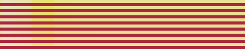
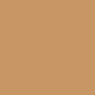
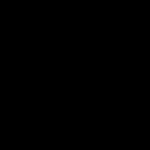
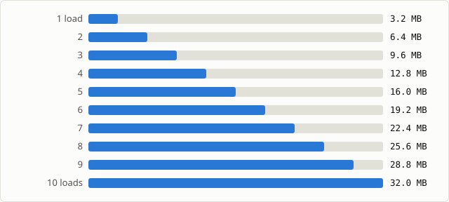
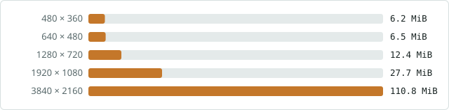

# Memory and correctness problems in OpenCV 4.x

Attachment to [opencv/opencv#30787](https://github.com/opencv/opencv/issues/30787).

An audit of opencv and opencv_contrib 4.x turned up the problems below, and each one was reproduced on the unmodified code. Wrong results and crashes are shown with the failing check or the sanitizer report. Memory and time are shown with numbers measured in a fresh process. This page shows the problems only; the fixes are linked at the end.

opencv 4.x [`2853bdc`](https://github.com/opencv/opencv/tree/2853bdce0d2cbad3d1009b3c88758cbd93d29300) · opencv_contrib 4.x [`2f5266f`](https://github.com/opencv/opencv_contrib/tree/2f5266f0489c8d32f23ce6d564a67ea7b2278a35) · Linux x86-64 · GCC 15.2 · 24 threads unless noted

Prepared by [@pctablet505](https://github.com/pctablet505). The audit and the measurements were done with an AI assistant (Claude); every result on this page was reproduced by running the code.

- **7** [wrong results, with no error raised](#wrong-results-with-no-error-raised)
- **5** [crashes, memory errors and a failing default](#crashes-memory-errors-and-a-failing-default)
- **8** [places where memory is never released](#memory-that-is-never-released)
- **26** [calls that use far more memory or time than they need](#calls-that-use-far-more-memory-or-time-than-they-need)

## Wrong results, with no error raised

These return normally, so nothing tells the caller the output is wrong.

### Images above about 5.6 megapixels come out wrong

**Wrong output** · photo · `edgePreservingFilter(NORMCONV_FILTER)`, `stylization()`

The normalized-convolution filter keeps its summed-area-table positions as float indices over all rows and channels. Past 2<sup>24</sup> a float cannot hold every integer, so the filter reads neighbouring values. It happens when 3 · max(rows · (cols + 1), cols · (rows + 1)) > 2<sup>24</sup>. The smallest square that triggers it is 2365 × 2365, so 4K frames and 12 MP phone photos are affected; 2560 × 1440 is not.

| | Crops of 480 × 96 pixels at x = 0, y = 1080 |
|:--|:--|
| input: every row one colour |  |
| expected: same rows, 1000 px wide |  |
| **4.x output at 3840 × 2160** |  |

Every input row is one colour, so the right answer at any width is the result for the same rows at 1000 px, repeated along each row. At 3840 × 2160, 4,148,844 of 8,294,400 pixels (50%) are wrong, by up to 116 levels: light rows come out BGR (150, 225, 235) instead of (215, 225, 235). At 2560 × 1440 the same check finds 0 wrong pixels.

- **Who hits it:** Anyone filtering or stylizing 4K video or full-resolution photos.
- **Source:** [npr.hpp:226-301](https://github.com/opencv/opencv/blob/2853bdce0d2cbad3d1009b3c88758cbd93d29300/modules/photo/src/npr.hpp#L226-L301) keeps the indices as `CV_32F`; [:340-390](https://github.com/opencv/opencv/blob/2853bdce0d2cbad3d1009b3c88758cbd93d29300/modules/photo/src/npr.hpp#L340-L390) decodes them.

<details><summary>Reproduce</summary>

```cpp
auto bands = [](int w) {               // 2160 rows, 6-row bands, each row one colour
    cv::Mat m(2160, w, CV_8UC3);
    for (int i = 0; i < m.rows; i++)
        m.row(i).setTo((i / 6) % 2 ? cv::Scalar(60, 40, 170) : cv::Scalar(215, 225, 235));
    return m;
};
cv::Mat out, narrow, expected;
cv::edgePreservingFilter(bands(3840), out, cv::NORMCONV_FILTER);
cv::edgePreservingFilter(bands(1000), narrow, cv::NORMCONV_FILTER);  // below the limit
cv::repeat(narrow.col(0), 1, 3840, expected);  // uniform rows: same result at any width
std::cout << cv::norm(out, expected, cv::NORM_INF) << "\n";  // 4.x: 116, expected 0
```

</details>

### Small, nearly flat images come out black

**Wrong output** · photo · `edgePreservingFilter(NORMCONV_FILTER)`, `stylization()`

For the first pixel of each row, the search for the end of its box stops at `w` instead of `w + 1`. When a whole row lies within the filter radius, as in a flat image under about 91 px wide at the default `sigma_s = 60`, that box is empty, 0/0 gives NaN, and the NaN spreads. This is the cause of [opencv#29614](https://github.com/opencv/opencv/issues/29614); on 5.x, [#29629](https://github.com/opencv/opencv/pull/29629) skips only rows of width 1, and 4.x has no guard.

| input 64 × 64<br>BGR (100, 150, 200) | **edgePreservingFilter**<br>mean (0, 0, 0) | **stylization**<br>mean (0, 0, 0) | same at 96 × 96<br>(100, 150, 200) |
|:-:|:-:|:-:|:-:|
|  |  |  |  |

Output of the unmodified filters, enlarged. A check over seven flat sizes from 1 × 1 to 91 × 91, for both functions, fails 14 of 14 times on 4.x (the output is 200 levels off).

- **Who hits it:** Thumbnails, small ROIs and narrow strips; any row that is flat or low in contrast and narrower than about 91 px.
- **Source:** [npr.hpp:257-263](https://github.com/opencv/opencv/blob/2853bdce0d2cbad3d1009b3c88758cbd93d29300/modules/photo/src/npr.hpp#L257-L263), the first pixel's upper search.

<details><summary>Reproduce</summary>

```cpp
cv::Mat src(64, 64, CV_8UC3, cv::Scalar(100, 150, 200)), dst;
cv::edgePreservingFilter(src, dst, cv::NORMCONV_FILTER);
std::cout << cv::mean(dst) << "\n";  // 4.x: [0, 0, 0, 0]; at 96 x 96: [100, 150, 200, 0]
```

</details>

### KAZE describes given keypoints differently from `detectAndCompute()`

**Wrong output** · features2d · `KAZE::compute()`

With keypoints supplied, detection is skipped, and with it the step that computes the scale-normalized derivatives. Orientation and descriptors then read the derivatives left over from the conductivity step, which are not normalized.

**Output on 4.x**

```
detectAndCompute(tsukuba.png) vs compute() on the same keypoints
max |descriptor difference| = 0.556665        (expected 0)
1280 x 720 synthetic image, 21 keypoints: mean |difference| 0.024
against a mean |descriptor| of 0.103; max 0.314
```

- **Who hits it:** Pipelines that describe keypoints from another detector, from tracking, or from a cache.
- **Source:** [kaze.cpp:153-156](https://github.com/opencv/opencv/blob/2853bdce0d2cbad3d1009b3c88758cbd93d29300/modules/features2d/src/kaze.cpp#L153-L156) skips detection; the derivatives are computed only inside it, at [KAZEFeatures.cpp:161-167](https://github.com/opencv/opencv/blob/2853bdce0d2cbad3d1009b3c88758cbd93d29300/modules/features2d/src/kaze/KAZEFeatures.cpp#L161-L167).

<details><summary>Reproduce</summary>

```cpp
cv::Mat img = cv::imread("tsukuba.png", cv::IMREAD_GRAYSCALE);  // opencv_extra/testdata/features2d
cv::Ptr<cv::KAZE> kaze = cv::KAZE::create();
std::vector<cv::KeyPoint> kp;
cv::Mat d1, d2;
kaze->detectAndCompute(img, cv::noArray(), kp, d1);
kaze->compute(img, kp, d2);
std::cout << cv::norm(d1, d2, cv::NORM_INF) << "\n";  // 4.x: 0.556665, expected 0
```

</details>

### Stride-2 SAME convolutions give wrong output after the input size changes

**Wrong output** · dnn · `Net` reused across input sizes

SAME padding depends on the input size. On a new input shape the layer recomputes its pads, but in three cases it keeps the packed convolution built with the old pads: 2-D convolutions on inputs under 12 px, all 1-D and 3-D convolutions, and every convolution after `enableWinograd(false)`.

**Output on 4.x:** one 3 × 3, stride-2 SAME convolution, compared with a fresh `Net`

```
input 10x10, then 9x9:  max |difference| = 4.60507   (expected 0)
input 9x9, then 10x10:  max |difference| = 6.50663   (expected 0)
```

- **Who hits it:** Apps that feed one Net several input sizes, such as video at changing resolution or multi-scale inference.
- **Source:** [convolution_layer.cpp:453-458](https://github.com/opencv/opencv/blob/2853bdce0d2cbad3d1009b3c88758cbd93d29300/modules/dnn/src/layers/convolution_layer.cpp#L453-L458): the only place the packed convolution is reset, through the Winograd check.

<details><summary>Reproduce</summary>

```cpp
cv::dnn::LayerParams lp;
lp.type = "Convolution"; lp.name = "conv";
lp.set("kernel_size", 3); lp.set("stride", 2); lp.set("num_output", 4);
lp.set("pad_mode", "SAME"); lp.set("bias_term", false);
int ws[] = {4, 3, 3, 3}; cv::Mat w(4, ws, CV_32F); cv::randu(w, -1, 1); lp.blobs.push_back(w);
int s0[] = {1, 3, 10, 10}, s1[] = {1, 3, 9, 9};
cv::Mat a(4, s0, CV_32F), b(4, s1, CV_32F); cv::randu(a, -1, 1); cv::randu(b, -1, 1);
cv::dnn::Net net;   net.addLayerToPrev(lp.name, lp.type, lp);
net.setInput(a);    net.forward();
net.setInput(b);    cv::Mat out = net.forward();
cv::dnn::Net fresh; fresh.addLayerToPrev(lp.name, lp.type, lp);
fresh.setInput(b);  cv::Mat ref = fresh.forward();
std::cout << cv::norm(out, ref, cv::NORM_INF) << "\n";  // 4.x: about 4.6, expected 0
```

</details>

### DIS optical flow reuses the initial flow of an earlier call

**Wrong output** · video · `DISOpticalFlow::calc()`

When `calc()` gets an initial flow, the object stores it per pyramid level. A later `calc()` without one still uses the stored flow, because nothing clears it.

**Output on 4.x**

```
calc() without an initial flow, after a call with one,
compared with a fresh object:  max |difference| = 0.210853 px   (expected 0)
```

- **Who hits it:** Video code that sometimes passes a predicted flow and sometimes does not, on one object.
- **Source:** [dis_flow.cpp:318-327](https://github.com/opencv/opencv/blob/2853bdce0d2cbad3d1009b3c88758cbd93d29300/modules/video/src/dis_flow.cpp#L318-L327) fills `initial_Ux` and `initial_Uy`, and only when a flow is passed.

### EdgeDrawing validates later images against the first image's size

**Wrong output** · ximgproc · `EdgeDrawing::detectLines()`, `detectEllipses()`

The table that validates line segments (NFA) depends on the image size, but each detector builds it only once, so every later image is validated with the first image's thresholds.

**Output on 4.x**

```
one detector: 64x48 image, then a 1280x960 image  -> 2885 lines
fresh detector on the same 1280x960 image          -> 2731 lines
same code with the table rebuilt for each image    -> 2731 and 2731
```

- **Who hits it:** Anyone who keeps one detector for images of different sizes.
- **Source:** [edge_drawing.cpp:1612-1618](https://github.com/opencv/opencv_contrib/blob/2f5266f0489c8d32f23ce6d564a67ea7b2278a35/modules/ximgproc/src/edge_drawing.cpp#L1612-L1618), and the same pattern at [:3217-3223](https://github.com/opencv/opencv_contrib/blob/2f5266f0489c8d32f23ce6d564a67ea7b2278a35/modules/ximgproc/src/edge_drawing.cpp#L3217-L3223) for ellipses.

### CUDA Generalized Hough returns garbage votes

**Wrong output** · cudaimgproc · `GeneralizedHoughBallard` / `Guil::detect(..., votes)`

The vote counts are `int3` on the device, but they are copied out through a `float4` view: the type is wrong, and the 16-byte stride walks over 12-byte data.

**Output on 4.x,** same image and template

```
GPU votes  type CV_32FC4:  [3.6714e-43, 0, 0, 5.54914e-43]  [0, 0, 3.78351e-43, 0]  [0, 0, 0, 0]
CPU votes  type CV_32SC3:  [260, 0, 0]  [268, 0, 0]  [393, 0, 0]
```

- **Source:** [generalized_hough.cpp:429-433](https://github.com/opencv/opencv_contrib/blob/2f5266f0489c8d32f23ce6d564a67ea7b2278a35/modules/cudaimgproc/src/generalized_hough.cpp#L429-L433)

## Crashes, memory errors and a failing default

### DIS optical flow crashes on the first `calc()` after `collectGarbage()`

**Crash** · video · `DISOpticalFlow::collectGarbage()`

`collectGarbage()` clears the variational refinement processors, which only the constructor creates. The next `calc()` indexes the empty vector at every pyramid level.

**Output on 4.x:** calc, collectGarbage, calc on the RubberWhale frames

```
[ RUN      ] DenseOpticalFlow_DIS.calc_after_collectGarbage
Segmentation fault (exit code 139)
```

- **Source:** [dis_flow.cpp:1569-1572](https://github.com/opencv/opencv/blob/2853bdce0d2cbad3d1009b3c88758cbd93d29300/modules/video/src/dis_flow.cpp#L1569-L1572) clears the vector; [:1516](https://github.com/opencv/opencv/blob/2853bdce0d2cbad3d1009b3c88758cbd93d29300/modules/video/src/dis_flow.cpp#L1516) indexes it.

### LSH: searching a loaded index crashes when `key_size` < 20, and every load leaks the dataset

**Crash, leak** · flann · `Index::load()` with `LshIndexParams`

`load()` builds the index with the default key size of 20 and its probe masks. `loadIndex()` then reads the saved key size but never rebuilds the masks, so with smaller keys the probes fall outside the bucket table. The feature-matching tutorial uses 12. `loadIndex()` also reads the saved dataset into memory that nothing frees, and indexes that copy instead of the features passed to `load()`.

**Output on 4.x:** build, save, load, knnSearch with `LshIndexParams(6, key_size, 1)`

```
key_size 10, 12, 16, 18:  Segmentation fault (exit code 139)
key_size 20, 22, 24:      ok
saved from one feature set, loaded with another, each row of the second searched:
  nearest index -1 (expected i), distance 2147483647 (expected 0)
```



Memory still held after each load and destroy of an index over 100,000 descriptors of 32 bytes: 3.2 MB more every time.

- **Source:** [lsh_index.h:141-155](https://github.com/opencv/opencv/blob/2853bdce0d2cbad3d1009b3c88758cbd93d29300/modules/flann/include/opencv2/flann/lsh_index.h#L141-L155)

### Line descriptor matching writes past a buffer after `train()`, and reads past a short mask

**Memory error** · line_descriptor · `BinaryDescriptorMatcher`

`train()` resets the count of stored descriptors to 0 when nothing new was added. `radiusMatch()` calls `train()`, sizes its result buffer from that count, and then writes every result into it. Separately, the overloads that take a query and a train set check the mask size with `&&` where `||` was meant, so a mask with too few rows passes the check and is read past its end.

**AddressSanitizer on the 4.x source:** add(), train(), radiusMatch()

```
ERROR: AddressSanitizer: heap-buffer-overflow
WRITE of size 4
    #0 BinaryDescriptorMatcher::Mihasher::query      binary_descriptor_matcher.cpp:708
    #1 BinaryDescriptorMatcher::Mihasher::batchquery binary_descriptor_matcher.cpp:617
    #2 BinaryDescriptorMatcher::radiusMatch          binary_descriptor_matcher.cpp:538
allocated by: Mihasher::batchquery                   binary_descriptor_matcher.cpp:602
```

**AddressSanitizer on the 4.x source, release flags:** match() with a 5-row mask for 400 queries

```
ERROR: AddressSanitizer: heap-buffer-overflow
READ of size 1
    #0 BinaryDescriptorMatcher::match                binary_descriptor_matcher.cpp:234
is located 0 bytes after 77-byte region (the mask)
```

In a normal build, the first case returns no matches where 11 are expected for the first query, and the heap is corrupted afterwards.

- **Source:** [binary_descriptor_matcher.cpp:83-93](https://github.com/opencv/opencv_contrib/blob/2f5266f0489c8d32f23ce6d564a67ea7b2278a35/modules/line_descriptor/src/binary_descriptor_matcher.cpp#L83-L93) (`train()`); mask checks at [:207](https://github.com/opencv/opencv_contrib/blob/2f5266f0489c8d32f23ce6d564a67ea7b2278a35/modules/line_descriptor/src/binary_descriptor_matcher.cpp#L207) and [:440](https://github.com/opencv/opencv_contrib/blob/2f5266f0489c8d32f23ce6d564a67ea7b2278a35/modules/line_descriptor/src/binary_descriptor_matcher.cpp#L440).

### `RgbdNormals` frees its implementation twice after a rejected window size

**Memory error** · rgbd · `RgbdNormals`

When a parameter changes, `initialize()` deletes the old implementation and builds a new one. If the new window size is rejected, the build throws, the deleted pointer stays in the object, and the destructor deletes it again.

**AddressSanitizer on the 4.x source:** compute normals, setWindowSize(4), compute again, destroy

```
ERROR: AddressSanitizer: heap-use-after-free
    #0 delete_normals_impl          normal.cpp:690
    #1 RgbdNormals::~RgbdNormals()  normal.cpp:702
freed by:   RgbdNormals::initialize()  normal.cpp:756
allocated:  RgbdNormals::initialize()  normal.cpp:753
In a normal build: Segmentation fault (exit code 139)
```

- **Source:** [normal.cpp:750-759](https://github.com/opencv/opencv_contrib/blob/2f5266f0489c8d32f23ce6d564a67ea7b2278a35/modules/rgbd/src/normal.cpp#L750-L759)

### Dense RLOF fails with its default parameters at 1080p

**Fails by default** · optflow · `calcOpticalFlowDenseRLOF()`

The default 6 × 6 grid gives 320 × 180 = 57,600 points at 1920 × 1080. The default interpolation, `INTERP_EPIC`, requires fewer than 32,767 matches.

**Output on 4.x,** default parameters

```
1280 x 720:   ok
1920 x 1080:  error: (-215:Assertion failed) match_num<SHRT_MAX in function 'interpolate'
3840 x 2160:  error: (-215:Assertion failed) match_num<SHRT_MAX in function 'interpolate'
```

- **Source:** [sparse_match_interpolators.cpp:204](https://github.com/opencv/opencv_contrib/blob/2f5266f0489c8d32f23ce6d564a67ea7b2278a35/modules/ximgproc/src/sparse_match_interpolators.cpp#L204). Each possible fix changes behaviour: widen the grid above the limit, switch to `INTERP_GEO`, or lift the 16-bit limit.

## Memory that is never released

Measured as memory still allocated after the call returns, in a fresh process.

| Where | What grows | Measured on 4.x |
|:--|:--|:--|
| `Index::load()` with LSH<br><sub>flann · [above](#lsh-searching-a-loaded-index-crashes-when-key_size--20-and-every-load-leaks-the-dataset)</sub> | a copy of the dataset, per load | 3.2 MB per load (100,000 × 32 B) |
| `EdgeBoxes::getBoundingBoxes()`<br><sub>ximgproc</sub> | index lists that are never cleared | 41.6 → 43.1 MB over 40 calls at 1080p |
| OCR beam-search CNN classifier `eval()`<br><sub>text</sub> | a probability array per window | 12,600 B per call (200 × 50); 117,421 B (1920 × 64) |
| `knnMatch()` with a mask of the wrong size<br><sub>line_descriptor</sub> | buffers on the early return | 310,816 B per call |
| `DepthCleaner` after a parameter change<br><sub>rgbd</sub> | the old implementation | 24 B per change |
| `DualTVL1OpticalFlow::collectGarbage()`<br><sub>optflow</sub> | the gamma buffers stay allocated | keeps 66.4 MB (gamma 0), 86.9 MB (gamma 0.1) at 1080p |
| BatchNorm-fused convolution after an input-size change<br><sub>dnn</sub> | a second copy of the fused weights | +18.9 MB: 137.5 MB at 32 × 32, 156.3 MB after 48 × 48 and back (8 convolutions, 3 × 3, 256 channels) |
| `cuda::CLAHE::collectGarbage()`, 16-bit input<br><sub>cudaimgproc</sub> | the histogram buffer | keeps 16.0 MiB |

## Calls that use far more memory or time than they need

Largest first. "Peak" is the heap high-water mark during one call above the level before it; "allocated" is the total of all allocations in the call.



Example: peak memory per `TrackerCSRT::update()` grows with the frame, although the tracker only uses a region around a 100 × 100 target. Each update also makes 25,818 to 25,824 heap allocations, at every frame size.

| Where | Input | Measured on 4.x | Why |
|:--|:--|:--|:--|
| `KAZE::detectAndCompute()`<br><sub>features2d</sub> | 3840 × 2160<br>1920 × 1080 photo | peak 4,180 MiB, 1,820 ms<br>peak 1,047 MiB, 428 ms | keeps 8 or more full-size planes per pyramid level |
| `stylization()`<br><sub>photo</sub> | 1080p<br>4K | peak 259 MiB, 641 ms, 72,756 allocations<br>peak 1,036 MiB | full-frame transposes, index maps and copies; one thread only |
| `edgePreservingFilter()` NC / RF<br><sub>photo</sub> | 1080p | peak 245 / 190 MiB, 633 / 197 ms | same; one thread only |
| `pencilSketch()` / `detailEnhance()`<br><sub>photo</sub> | 1080p | peak 261 / 234 MiB, 293 / 168 ms | same; one thread only |
| `TrackerCSRT::update()`<br><sub>tracking</sub> | 3840 × 2160 | peak 110.8 MiB, 26.3 ms, 25,820 allocations | converts and segments the whole frame; scratch matrices rebuilt per update |
| `PCA`, 16 components<br><sub>core</sub> | 500 × 100,000 | peak 384 MiB, 3,280 ms | back-projects every component, not only the kept ones |
| `TrackerNano`<br><sub>video</sub> | 3840 × 2160 | holds 27.1 MB after init; 32.8 MB allocated per update, 60.7 MB near a border | clones each frame into a member; pads the whole frame |
| `TrackerDaSiamRPN`<br><sub>video</sub> | 3840 × 2160 | 69.1 MB allocated per update, 96.9 MB near a border | same |
| `calcOpticalFlowDenseRLOF()`<br><sub>optflow</sub> | 1080p | 2,326,989 allocations, 822 ms (robust norm); 904,181 (standard) | per-range buffers rebuilt for every range |
| `VariationalRefinement::calc()`<br><sub>video</sub> | 1080p<br>4K | 45 MB allocated per call<br>179 MB | five temporary full-size planes per call |
| MSLIC superpixels<br><sub>ximgproc</sub> | 720p<br>1080p | 12,360,121 allocations, 705 ms<br>28,269,979, 1,518 ms | two vectors allocated per pixel per iteration |
| `BinaryDescriptorMatcher::radiusMatch()`<br><sub>line_descriptor</sub> | 600 × 600 descriptors | 3,961,788 allocations, 229 ms | distances recomputed for each match |
| `WeChatQRCode::detectAndDecode()`<br><sub>wechat_qrcode</sub> | 1080p, nothing decodes | 244 to 270 MB allocated, peak 100 MB per call | 11 MB of it: binarizer arrays that are never written |
| `GeneralizedHoughGuil::detect()`<br><sub>imgproc</sub> | 1080p | peak 103.1 MB, 140 ms | point list grows without a reserve |
| `QRCodeDetector::detectAndDecode()`<br><sub>objdetect</sub> | 3840 × 2160 | peak 97.9 MB | extra full copies of the image |
| `DualTVL1OpticalFlow`, gamma = 0<br><sub>optflow</sub> | 1080p | 49.8 MB of the 322.8 MB peak | gamma buffers allocated even when gamma is 0 |
| `MatMul` with a constant bias<br><sub>dnn</sub> | 2048 × 768 by 768 × 3072 | holds a 25.2 MB output-sized copy of the bias | bias broadcast to the output shape (M · N · 4 bytes per layer) |
| KD-tree / hierarchical `knnSearch()`<br><sub>flann</sub> | 100,000 points | 12,812 / 13,621 B allocated per query | visited set allocated per query |
| `SIFT::detectAndCompute()`<br><sub>features2d</sub> | boat1.jpg, 4,452 keypoints | 47,002 allocations | a buffer list that grows one block at a time, per keypoint |
| `warpPolar()`, inverse<br><sub>imgproc</sub> | 1080p | 8,791 allocations, 5.06 ms | row buffers allocated per row |
| `setTo()` and arithmetic with a scalar or mask<br><sub>core</sub> | any size | one heap allocation per call | scratch buffer on the heap |
| `cuda::HoughCirclesDetector`<br><sub>cudaimgproc</sub> | 1080p<br>4K | downloads 7.9 MiB per call, 0.625 ms<br>31.7 MiB, 2.00 ms | copies the whole accumulator to the host each call |
| `cuda::FarnebackOpticalFlow`<br><sub>cudaoptflow</sub> | 1080p | 12 allocations per call, 3.77 ms | buffers and streams created per call |
| `cuda::DensePyrLKOpticalFlow`<br><sub>cudaoptflow</sub> | 4K | peak 274.2 MiB | finest level computed into scratch, then copied |
| `cuda::sqrIntegral()`<br><sub>cudaarithm</sub> | 4K | peak 127.6 MiB | result built in a buffer, then copied |
| `cuda::CannyEdgeDetector`<br><sub>cudaimgproc</sub> | any size | a cudaMalloc and cudaFree per call | counter allocated per call |

## How this was measured

- **Code:** opencv 4.x at [2853bdc](https://github.com/opencv/opencv/tree/2853bdce0d2cbad3d1009b3c88758cbd93d29300) and opencv_contrib 4.x at [2f5266f](https://github.com/opencv/opencv_contrib/tree/2f5266f0489c8d32f23ce6d564a67ea7b2278a35), Release builds with GCC 15.2 and glibc 2.43 on Linux x86-64; Ryzen 9 9950X3D with 24 threads; RTX PRO 6000 Blackwell with CUDA 13.2 for the CUDA rows.
- **Memory:** every run is a fresh process with a malloc interposer that counts allocations and bytes, and records the peak above the level before the call and what the call leaves allocated. Blocks of 1 MiB or more are mapped directly, so their sizes are exact. CUDA rows count `GpuMat` allocations through a counting allocator, per call after a warm-up call.
- **Time:** wall clock on an otherwise idle machine. Photo filter times are OpenCV's perf tests (medians, one thread).
- **Wrong results and crashes:** each has a test or a short program, and the output shown is from the unmodified libraries. Memory errors come from AddressSanitizer builds of the affected source files.

## Fixes

Fixes are ready for everything above except three items: the dense RLOF default, which needs a maintainer's choice between the three behaviours; CSRT's allocation count; and two of the five planes that `VariationalRefinement::calc()` allocates per call. Each bug fix comes with a test that fails on 4.x, and each memory fix keeps the output bit-identical. They are in two draft pull requests, one in opencv and one in opencv_contrib, linked from the issue; their descriptions give before and after numbers.
